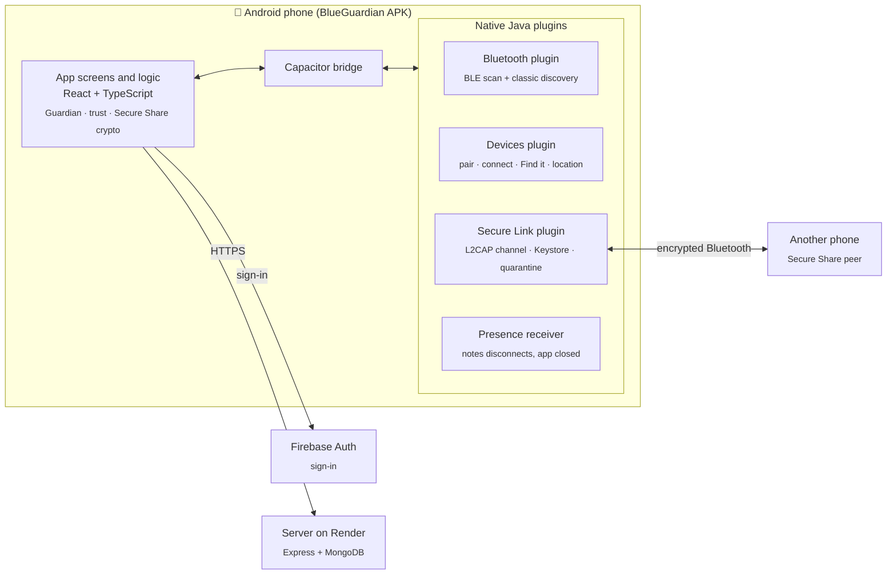

<div align="center">


# BlueGuardian AI

**An intelligent Bluetooth trust and recovery framework for secure device protection**

Check every Bluetooth device around you before you connect, share files phone to phone with end-to-end encryption, and find what you've lost — on your own or with the help of other users.

[](https://github.com/YuvarajRaghavann/BlueGuardian-AI/actions/workflows/build-android-shell.yml)


[Features](#features) · [How it works](#how-it-works) · [Get the app](#get-the-app) · [Develop](#develop-locally) · [Documentation](#documentation) · [Journey](docs/journey/JOURNEY.md)

</div>

---

## Why BlueGuardian

Bluetooth connects us to earbuds, watches, cars and phones dozens of times a day — usually with no idea whether the device on the other end is what it claims to be. Look-alike devices, disguised keyboards that can type commands, pairing-popup spam and trackers that follow people are real, documented attacks.

BlueGuardian makes those risks visible and gives people simple, safe actions: **check before you connect, share without the internet, and recover what you lose.** Everything security-critical runs on the phone; the server is only used for accounts and community recovery.

## Features

| | Feature | What it does |
| --- | --- | --- |
| 📡 | **Nearby devices** | Scans Bluetooth Low Energy and Classic at the same time (~12 s), merges duplicates, shows paired and connected devices instantly, and keeps the list accurate even when devices rotate their addresses. |
| 🛡️ | **Guardian check** | An instant **Safe / Caution / Unsafe** verdict from what a device broadcasts: verified maker ID vs. claimed brand, disguised names, hidden keyboards, popup spam. Optional deep check reads device information without pairing. |
| 📈 | **Trust over time** | A Beta-reputation trust score (subjective logic) built from real evidence that fades over 14 days. Every point is explained. |
| 🚨 | **Alerts** | Trackers following you, pairing-popup spam and look-alike copies of your own devices — raised only on real evidence. |
| 🔗 | **Pair and connect** | Pairs end to end, waits for Android to connect audio, and reports the real connection state live. |
| 🔒 | **Secure Share** | Phone-to-phone files and chat over Bluetooth LE: Noise XX handshake, 6-digit code check, encrypted chunks, resumable transfers, quarantine — and **BTGuard**, which re-checks the link every second. |
| 📍 | **Find my devices** | Remembers where your phone was when each device disconnected (even with the app closed), a signal meter to walk towards it, and one-tap sharing. |
| 🤝 | **Community recovery** | Report a device lost; other users' phones spot it and tell only you. Matching uses hashed fingerprints, never raw addresses. |

## How it works



- **The app** is a React + TypeScript web app running inside a [Capacitor](https://capacitorjs.com) Android shell. All security logic lives here so it is written once and unit-tested.
- **Four Java plugins** do what only Android can: Bluetooth radios, pairing, encrypted channels, the Android Keystore, location, and a background receiver.
- **The server** (Express + MongoDB on Render) is optional and only used for accounts and community recovery. It verifies Firebase tokens and scopes every query to the signed-in user.

Read the full walkthrough in the **[Technical Guide](docs/guide/TECHNICAL_GUIDE.md)**.

## Get the app

The APK is built by GitHub Actions on every push to `main` and to `android/phase*` branches — no Android Studio needed.

1. Open the latest run of **[Build BlueGuardian Android Shell](https://github.com/YuvarajRaghavann/BlueGuardian-AI/actions/workflows/build-android-shell.yml)**.
2. Under **Artifacts**, download `blueguardian-android-debug-<commit>` and unzip `app-debug.apk`.
3. Install it on an Android 8+ phone (uninstall any earlier debug build first — each debug build is signed with a new key).
4. Allow **Nearby devices** and **Location** when asked. Android hides most Bluetooth devices from apps without location.

Full instructions, including signed release builds and server deployment: **[Getting Started](docs/guide/GETTING_STARTED.md)**.

## Develop locally

Requirements: **Node.js 24** (see [`.nvmrc`](.nvmrc)), and Python 3.10+ only for the BTGuard and icon tools.

```bash
# App (runs in the browser with Web Bluetooth; native features need the APK)
npm install
npm run dev          # start the dev server
npm test             # unit tests (Vitest)
npm run build        # type-check + production build

# Server
cd backend
cp .env.example .env # then fill in MONGODB_URI
npm install
npm run dev          # http://localhost:4000/api/health
npm run test:ci      # tests + TypeScript build
```

## Project structure

```text
BlueGuardian-AI/
├── src/                 React + TypeScript app
│   ├── pages/           one file per screen (Home, Around, Alerts, Find, Share, …)
│   ├── components/      device card, detail sheet, Guardian panel, connect panel …
│   ├── ui/              design kit, bottom sheet, radar, trust dial, logo
│   ├── context/         app-wide state (devices, threats, actions, Secure Share)
│   ├── services/        native bridges, server API, sign-in, on-phone storage
│   ├── intel/           Guardian check + learning engine (trackers, spam, trust)
│   ├── secure/          Secure Share: crypto, Noise handshake, sessions, BTGuard
│   └── utils/           small shared rules
├── native/android/      Java plugins, MainActivity, launcher icons and splash
├── backend/             Express + MongoDB server (accounts, recovery, sync)
├── btguard/             Python reference trust engine, simulator, training
├── ml-training/         device-risk model schema and training script
├── branding/            logo source and icon generator
├── scripts/             build-time Android project preparation
├── docs/                guides, architecture, product and project journey
└── .github/             CI workflow and issue / PR templates
```

Looking for the exact file behind a feature? See the **[Feature Map](docs/guide/FEATURE_MAP.md)**.

## Documentation

| Document | For |
| --- | --- |
| [Technical Guide](docs/guide/TECHNICAL_GUIDE.md) | How every part works, end to end |
| [Feature Map](docs/guide/FEATURE_MAP.md) | Where each feature lives in the code |
| [Getting Started](docs/guide/GETTING_STARTED.md) | Install, build, run and deploy |
| [Architecture notes](docs/README.md#architecture) | Design records: Secure Link, AI model, recovery |
| [Product specification](docs/product/product-spec.md) | Goals, users and scope |
| [Project journey](docs/journey/JOURNEY.md) | How BlueGuardian was built, phase by phase |
| [Changelog](CHANGELOG.md) | Notable changes by release |

## Tech stack

**App:** React 19 · TypeScript · Vite 8 · Tailwind CSS 3 · Framer Motion · lucide-react · Capacitor 8
**Android:** Java plugins · Android SDK 36 · BLE + Classic Bluetooth · L2CAP channels · Android Keystore / StrongBox
**Security:** X25519 · ChaCha20-Poly1305 · SHA-256 / HKDF · Noise XX · hash-chained forensic log
**Server:** Node.js 24 · Express · MongoDB (Mongoose) · Zod · Helmet · Firebase Authentication
**Research tooling:** Python · NumPy (BTGuard trust engine, federated learning experiments)
**CI/CD:** GitHub Actions (tests + APK) · Render (server)

## Security

Security model, hardening and how to report a vulnerability: **[SECURITY.md](SECURITY.md)**. Please don't open public issues for security problems.

## Academic context

BlueGuardian AI is developed as an MSc Artificial Intelligence and Machine Learning dissertation project, *"BlueGuardian AI – An intelligent Bluetooth trust and recovery framework for secure device protection."* The [project journey](docs/journey/JOURNEY.md) records how it was designed and built.

## License

Copyright © 2026 Yuvaraj R. **All rights reserved.**

The source is published for reading and evaluation. No permission is granted to copy, modify, distribute or use it, in whole or in part, without prior written permission from the copyright holder. Third-party data and libraries keep their own licenses — see [NOTICE.md](NOTICE.md).
