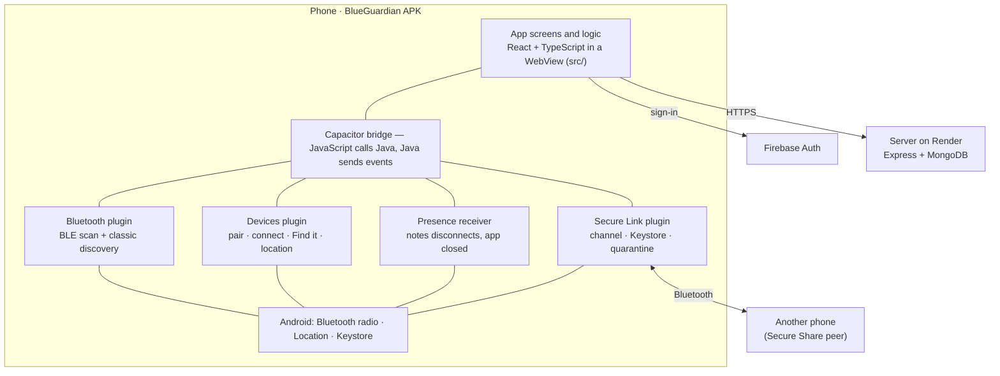
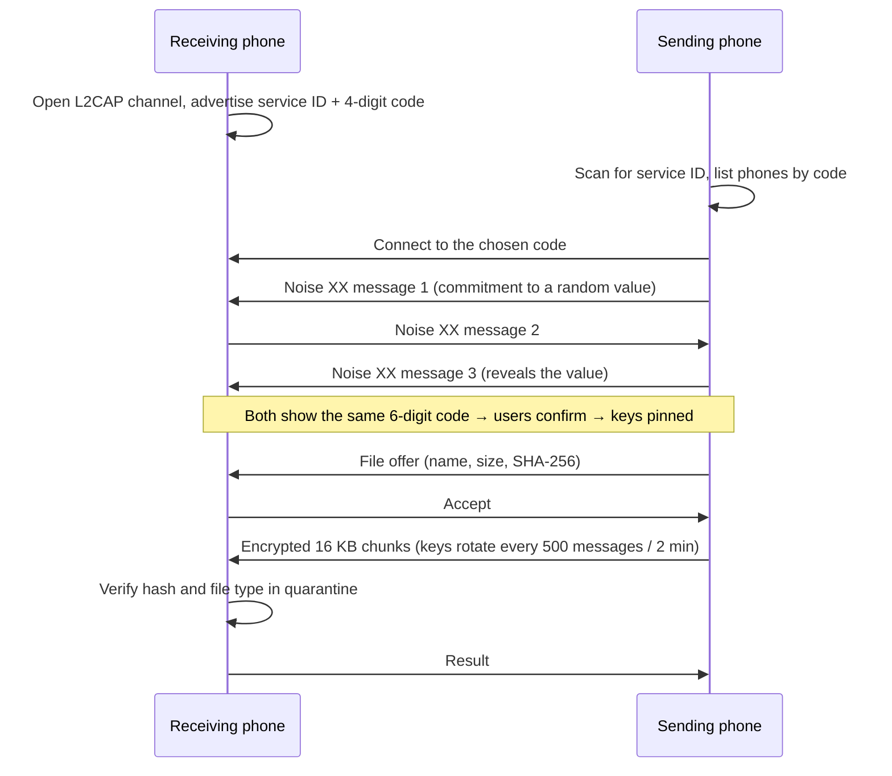

# BlueGuardian AI — Technical Guide

How every part of BlueGuardian works, end to end, and where it lives in the code. For a quick file lookup, use the [Feature Map](FEATURE_MAP.md).

**Contents**

1. [Overview and architecture](#1-overview-and-architecture)
2. [Nearby device scanning](#2-nearby-device-scanning)
3. [Guardian check, trust scores and alerts](#3-guardian-check-trust-scores-and-alerts)
4. [Pair and connect](#4-pair-and-connect)
5. [Secure Share](#5-secure-share-encrypted-phone-to-phone-files)
6. [Find my devices](#6-find-my-devices-loss-and-recovery)
7. [Community recovery](#7-community-recovery)
8. [Accounts, server and data](#8-accounts-server-and-data)
9. [Build, CI and deployment](#9-build-ci-and-deployment)
10. [Explaining it in two minutes](#10-explaining-it-in-two-minutes)

---

## 1. Overview and architecture

BlueGuardian is an Android app that checks every Bluetooth device near you, helps you connect safely, shares files phone to phone with end-to-end encryption, and helps you find lost devices — alone or with other users.

It is built in four layers:

1. **App screens and logic (React + TypeScript).** Every screen, all security logic (trust scoring, encryption, threat detection) and the state live in `src/`. They run inside an Android WebView.
2. **Android shell (Capacitor 8).** Capacitor wraps the web app as a real Android APK and lets JavaScript call Java code ("plugins") and receive events back.
3. **Native plugins (Java).** Four plugins in `native/android/` do what only Android can: Bluetooth scanning, pairing and connecting, encrypted phone-to-phone channels, the Android Keystore, location, and a background receiver that notices when devices disconnect.
4. **Server (Node.js + Express + MongoDB, on Render).** Only needed for accounts and community recovery. Sign-in uses Firebase; the server verifies Firebase tokens and keeps each user's data separate.

Everything else — scanning, safety verdicts, trust scores, Secure Share, Find my devices — works offline on the phone.



## 2. Nearby device scanning

One tap on **Scan** lists every Bluetooth device around you in about 12 seconds, each with a safety verdict. Two radios are searched at once, because devices show up in different ways:

- **Bluetooth Low Energy (BLE) scan** — phones, watches, trackers, earbuds out of the case, sensors. It reads each advertisement: name, maker ID, service IDs, signal strength (RSSI) and transmit power.
- **Classic discovery (inquiry)** — speakers, headsets, cars, earbuds in pairing mode. Android needs about 10 s for the inquiry plus time to look up names, so it gets a full 12 s.
- **Android's own list** — paired devices and those connected right now. Connected earbuds stop advertising, so a scan alone would miss them.

**What happens on a scan**

1. The BLE scan starts first and triggers the one-time permission prompts (Nearby devices + Location), so prompts never compete.
2. As soon as BLE is running, classic discovery starts alongside it and the paired/connected list is read.
3. Each sighting becomes a device record. Records with the same address merge into one, and the transports are remembered ("Dual signal" = seen on both radios).
4. Each device is processed at most once every 2.5 s; the radio repeats adverts about once a second, so this keeps the screen smooth.
5. When both searches end, the whole scan is handed to the learning engine (section 3) with the phone's location, if allowed.

**Why it is accurate**

- **Location permission is requested.** On Android 12+, an app that hasn't declared it never derives location from scans receives most results only with location granted and the Location switch on. The app asks, and warns when either is off.
- **Stale searches are cleared.** A leftover inquiry is cancelled and restarted, as Android Settings does.
- **Names fill in late.** Classic devices are often found before their name is known; the app listens for Android's "name changed" event and updates the row.
- **Bluetooth 5 adverts** (extended advertising) are scanned on phones that support them.
- **"Around you now" = the latest scan only.** Phones and earbuds rotate their BLE address every few minutes, so a wider window counted one device two or three times. Home and Around share one rule in `src/utils/aroundNow.ts`.
- **Nameless devices are folded away**, as in Android Settings, unless risky, paired or recognised.

**Where it lives:** `native/android/BlueGuardianBluetoothPlugin.java` (both radios) · `src/services/nativeBluetoothService.ts` (bridge) · `scanCombinedDevices` in `src/context/DeviceContext.tsx` (orchestration and merging) · `src/pages/AroundYou.tsx` (Around tab) · `src/pages/Dashboard.tsx` (Home).

## 3. Guardian check, trust scores and alerts

Every device gets two separate judgements: an instant **Guardian verdict** from what it broadcasts now, and a **trust score** built from how it behaves over days.

### Guardian verdict (instant, before you connect) — `src/intel/guardian.ts`

The check reads the device's own advertisement and returns Safe, Looks safe, Caution or Unsafe. Each check uses a published standard or a documented attack:

- **Identity** — the maker ID inside the advert (Bluetooth SIG company list, 4,000+ makers in `src/intel/data/companies.json`) must match the brand in the name. "AirPods" without Apple's ID (0x004C) is an impersonation.
- **Disguise** — hidden characters and look-alike letters in names.
- **Keyboard control** — Class of Device, services and appearance reveal keyboards and input devices, which can type commands once paired. A keyboard named like earbuds is flagged.
- **Known attacks** — pairing-popup spam, trackers moving with you, copies of your own devices.
- **Deep check (optional)** — connects without pairing, reads the Device Information service and tests whether the device protects its data. Never pairs (`inspectGatt` in `BlueGuardianDevicesPlugin.java`).

Any failed check means Unsafe; any warning means Caution. Connecting to a Caution or Unsafe device needs a second tap.

### Learning engine and alerts — `src/intel/engine.ts`, `src/intel/store.ts`

Every scan is fed to the engine, which keeps a profile per device (sightings, places, signal history) and learns what is normal around you.

| Alert | What triggers it |
| --- | --- |
| Tracker following you | An AirTag, SmartTag, Tile or Find My tag seen repeatedly at several places far apart |
| Pairing-popup spam | A burst of fake pairing popups well above your learned normal |
| Look-alike device | An unpaired device using the same name as one you paired |

Alerts become cards on the Alerts tab through `src/context/ThreatContext.tsx`. The engine's memory is stored on the phone and trimmed to fit (`src/intel/persist.ts`).

### Trust score (behaviour over time)

Trust uses a Beta reputation model from subjective logic. Good behaviour adds positive evidence *r*; warning signs add negative evidence *s*. Evidence loses half its weight every 14 days, so trust has to keep being earned.

```text
score     = (r + a·W) / (r + s + W)        a = 0.5 (neutral), W = 2
certainty = (r + s)   / (r + s + W)
```

| Evidence | Weight |
| --- | --- |
| Paired with this phone | +3 |
| You tapped Trust | +5 |
| Consistent sighting | +0.3 each, at most +1 a day |
| Connected | +0.5 |
| High / medium / low alert | −5 / −2 / −0.75 |
| Name or type changed | −1.5 |
| Unusual signal | −0.4 |
| You blocked it | −10 |

"Trusted" also needs your consent (pairing or tapping Trust). The constants are `TRUST` in `src/intel/engine.ts`; the explanation users see is in `src/components/DeviceDetailModal.tsx`.

## 4. Pair and connect

Tapping **Pair and connect** runs the same steps as Android's Bluetooth screen and only says "Connected" when Android reports a real connection. Logic: `connect()` in `native/android/BlueGuardianDevicesPlugin.java`. Button: `src/components/NativeConnectPanel.tsx`.

1. **Stop any inquiry** — pairing during a classic search is slow or fails.
2. **Already connected?** — checks Android's audio, call, hearing-aid, LE Audio and BLE connection lists.
3. **BLE-only gadget** (tag, band, sensor) — opens and keeps a data link (GATT); that link is the connection.
4. **Not paired** — starts pairing and keeps the request open while you accept Android's prompt (up to 45 s), listening for the bond-state broadcast.
5. **Paired** — Android connects audio/keyboard profiles itself right after pairing; the app waits up to 10 s and reports "Connected".
6. **Paired but disconnected earbuds** — see the limit below; the app opens Android's Bluetooth settings in one tap.

**Live status.** The plugin forwards Android's connect, disconnect and pairing broadcasts as events; `DeviceContext.tsx` applies them (`SET_LINK_STATE`) so every screen is current without a rescan. A "connected" flag saved in an earlier session is reset at start-up.

**Android limit.** On Android 12+, reconnecting audio for an already-paired device is a system-only function. Dual-mode earbuds are deliberately not given a background data link, because that would show "Connected" without audio.

## 5. Secure Share (encrypted phone-to-phone files)

Secure Share moves files and messages between two phones over Bluetooth, with no internet, using end-to-end encryption checked every second. The Java side only carries opaque encrypted bytes; all security logic is in TypeScript (`src/secure/`).



1. **Receive** — the receiving phone opens a Bluetooth LE data channel (an L2CAP connection-oriented channel on Android 10+, plus a GATT service that works from Android 8 and is the automatic fallback) and advertises BlueGuardian's service ID with the channel number and a random 4-digit code.
2. **Send** — the other phone scans for that service ID, lists each phone by code, and connects. Frames are length-prefixed, up to 70 KB.
3. **Handshake** — Noise XX (X25519, ChaCha20-Poly1305, SHA-256). The sender commits to a random value before seeing the receiver's, so an attacker in the middle cannot fish for a matching code.
4. **Confirm the code** — both screens show a 6-digit code from the handshake. When they match, the peer's key is pinned; next time it reconnects without the code.
5. **Share** — a signed manifest, then 16 KB encrypted chunks. Interrupted transfers resume from the last stored chunk.
6. **Receive safely** — each file must be accepted; chunks go into an app-private quarantine; the SHA-256 and the true file type are checked; apps and scripts are blocked; nothing opens automatically. "Save" copies to `Download/BlueGuardian`.

### Continuous trust (BTGuard) — `src/secure/trustEngine.ts`

| Signal | Measures |
| --- | --- |
| Crypto | Encrypted? Both sides verified? Key size |
| Physical | Signal-strength jumps (median of 5 readings) |
| Behaviour | Logistic regression over frame rate, extra connection attempts, failed decryptions and round-trip jitter (`trustModel.json`) |

Trust drops fast and recovers slowly. **FULL** allows files and chat; **RESTRICTED** pauses files and rotates keys; **ISOLATED** closes the link and revokes the pairing until the phones pair again in person, which also requires proving a secret from the first pairing. Jitter is measured robustly — samples taken while chunks are queued are ignored and 25 ms of normal Bluetooth delay is allowed — so a large transfer is not mistaken for an attack.

**Keys and evidence.** The identity key and peer secrets are encrypted with the Android Keystore (StrongBox when available). Every security event goes into a hash-chained log (`src/secure/forensicLog.ts`). The Python reference engine, simulator and training live in [`btguard/`](../../btguard/README.md).

**Where it lives:** `native/android/BlueGuardianSecureLinkPlugin.java` · `src/secure/noise.ts` · `src/secure/session.ts` · `src/secure/fileTypes.ts` · `src/context/SecureLinkContext.tsx` · `src/pages/SecureShare.tsx`. Design record: [SECURE_LINK.md](../architecture/SECURE_LINK.md).

## 6. Find my devices (loss and recovery)

The Find tab answers "where did I leave it?": the phone remembers where it was each time a device disconnected.

- **Presence receiver** — `BlueGuardianPresenceReceiver.java` is registered in the manifest for connect/disconnect broadcasts, so it runs even when the app is closed, and saves each event to a small store (`LastSeenStore`, SharedPreferences).
- **Last-seen place** — on a disconnect it asks for one location fix, preferring the fused/network provider (fast indoors), then GPS. A cached fix is used only if under 15 minutes old. With "Allow all the time" it works with the app closed.
- **While the app is open** — the spot is also saved every 5 minutes while a device is connected, and immediately on disconnect.
- **Find it** — `startProximity` runs a fast BLE scan plus repeated classic inquiries for one device and shows 1–4 signal bars; a connected device can play a beep. Earbuds in a closed case can't be detected by any phone.
- **Map and share** — opens the spot in a maps app, or shares a message with a Maps link and your optional contact.
- **Lost it?** — marks the device lost and offers **Ask the community**, which opens a community report with the device pre-selected.

**Where it lives:** `BlueGuardianPresenceReceiver.java` · `BlueGuardianDevicesPlugin.java` (`listKnownDevices`, `startProximity`, `saveCurrentLocationFor`, `share`, `openMap`) · `src/services/myDevices.ts` · `src/pages/Recovery.tsx`.

## 7. Community recovery

Other users' phones spot your lost device and tell only you, without either side learning who the other is.

1. **Report lost** — `POST /api/recovery/devices` with the device's address, its advertised name and BLE service IDs.
2. **Fingerprints, not addresses** — BLE addresses rotate, so the server stores two SHA-256 hashes of the normalised name: name + service IDs (strong match) and name alone (possible match).
3. **Help others** — a 10 s BLE scan plus a 10 s classic search collects up to 30 named devices and sends them to `POST /api/recovery/community/sightings`, with location only if the helper opted in.
4. **Matching** — the server hashes the same way and looks for lost or searching devices with the same strong hash, then name hash. A match creates a private sighting for the owner (confidence 0.45 strong, 0.2 possible); one per device per submission, duplicates within a minute dropped.
5. **Owner sees it** — the card moves Lost → Searching → Found → Recovered, with **Open in Maps**, a sighting timeline and "I'm near it" (a scan that must actually hear the device).

**Privacy rules in code:** helpers never learn whether anything matched; sightings never change a device's state on their own; location is stored only with opt-in; every owner query is filtered by the signed-in user's ID in the database query itself.

**Where it lives:** `src/pages/RecoveryCloud.tsx` · `src/services/api.ts` (`api.recovery`) · `backend/src/routes/recovery.ts` · `backend/src/services/recoveryService.ts` · `backend/src/models/Device.ts`, `RecoveryEncounter.ts`. Design record: [RECOVERY_IMPLEMENTATION.md](../architecture/RECOVERY_IMPLEMENTATION.md).

## 8. Accounts, server and data

An account is optional; it is needed only for community recovery and server sync.

**Sign-in.** `src/services/firebaseAuth.ts` signs in with Firebase email and password. `src/services/accountSession.ts` keeps you signed in by encrypting the Firebase refresh credential with an Android Keystore key before storing it. Each request carries a short-lived Firebase ID token.

**Server** (`backend/`, deployed on Render). Express with Helmet headers, a CORS allowlist (the app's WebView origin `https://localhost`), a 256 KB body limit and a 10-per-minute limit on recovery writes. `backend/src/auth.ts` verifies each Firebase token against Google's public keys and uses its user ID as the owner ID for every query.

| Endpoint | Purpose |
| --- | --- |
| `GET /api/health` | Server and database status |
| `/api/devices` | Owner's device registry (trust and block decisions) |
| `/api/threats` | Alerts sync |
| `/api/actions` | Trust, block and forget decisions |
| `/api/events` | Activity log |
| `/api/recovery/devices` | Report lost, list cases, change state, sightings |
| `/api/recovery/community/sightings` | Helper scans (community matching) |

| Data | Stored in | File |
| --- | --- | --- |
| Devices, assessments, actions | IndexedDB `blueguardian-local` | `src/services/localDatabase.ts` |
| Learning engine and trust history | WebView localStorage (capped at 2.5 MB) | `src/intel/store.ts`, `persist.ts` |
| Last-seen times and places | Android SharedPreferences | `BlueGuardianPresenceReceiver.java` |
| Secure Share keys and paired phones | localStorage, encrypted by Android Keystore | `src/secure/peerStore.ts` |
| Received files | App-private quarantine folder | `BlueGuardianSecureLinkPlugin.java` |
| Accounts, lost devices, sightings | MongoDB | `backend/src/models/` |

**Android hardening** (applied at build time by `scripts/prepare-capacitor-ci.mjs`): backups off, plain HTTP off, only system certificate authorities, optional certificate pinning, and only the permissions the features need.

## 9. Build, CI and deployment

The APK is built entirely in GitHub Actions (`.github/workflows/build-android-shell.yml`) on every push to `main` and `android/phase*` branches, or by hand.

| Job | What it does |
| --- | --- |
| Backend tests | Server test suite + TypeScript build |
| BTGuard tests | Python trust-engine tests + app model export check |
| Build debug APK | Builds the React app, runs frontend tests, generates the Android project (`npx cap add android`), applies `scripts/prepare-capacitor-ci.mjs`, compiles with Gradle (SDK 36) |

`prepare-capacitor-ci.mjs` copies the Java plugins and icons from `native/android/` into the generated project, adds permissions, registers the presence receiver, hardens the manifest and records `android-build-info.txt`. With the signing secrets set, the same workflow also produces a signed release APK. The server is described by `render.yaml`. Icons are regenerated with `python3 branding/render_icons.py`. Step-by-step instructions: [Getting Started](GETTING_STARTED.md).

## 10. Explaining it in two minutes

> BlueGuardian is a Bluetooth security app for Android. It scans both Bluetooth radios at once and gives every nearby device an instant safety verdict from what the device broadcasts: is the maker real, is the name disguised, is it secretly a keyboard? Over time it learns what's normal around you, raising alerts for trackers following you, pairing-popup spam and copies of your devices, and builds a trust score for each device with a reputation model whose evidence fades over two weeks.
>
> It also pairs and connects devices safely, shares files phone to phone over an encrypted Bluetooth channel — a Noise handshake, a 6-digit code check and a trust engine that re-checks the link every second — and helps you find lost devices: it remembers where your phone was when each device disconnected, has a signal meter, and lets other users' phones report sightings privately.
>
> Technically it's a React and TypeScript app inside a Capacitor Android shell, with four Java plugins for what only Android can do, and an Express + MongoDB server used only for accounts and community recovery.

**Design decisions**

- **Security logic in TypeScript, not Java** — one codebase, unit-tested in CI; Java only moves bytes and calls Android APIs.
- **Explainable verdicts** — every check and trust change has a plain-language reason.
- **Offline first** — only accounts and community recovery need the server.
- **Privacy by design** — hashed fingerprints, anonymous helpers, location always opt-in.
- **Fail safe** — unknown is not "risky"; Trusted needs consent; a suspicious Secure Share link loses files before chat.

**Known limits**

- Android 12+ lets only its own settings reconnect paired earbuds; the app hands off in one tap.
- Earbuds in a closed case don't transmit, so no phone can detect them.
- Signal strength gives a rough distance band, not metres.
- Community matches are leads based on the device's name; the owner confirms.
- The BTGuard behaviour model was trained on simulated sessions; its thresholds were tuned for real phones in October 2026 and should be validated with field data.
- Secure Share works on Android 8+; two Android 10+ phones use the faster L2CAP channel, otherwise the GATT transport is used automatically.
