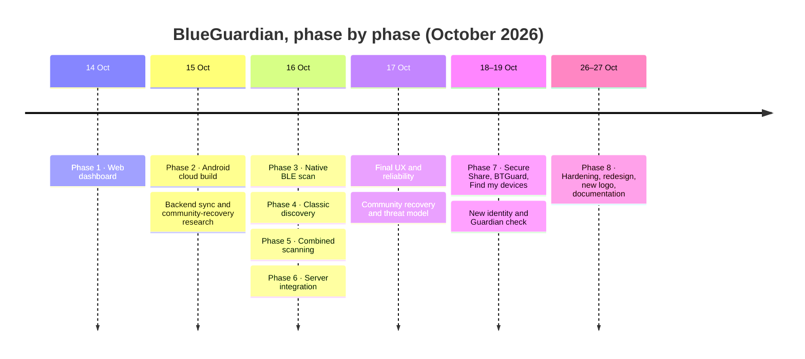

# The BlueGuardian journey

How BlueGuardian went from a browser dashboard to a native Android security app in eight phases, between **14 and 27 October 2026** — more than 200 commits, each phase on its own branch with its own CI build.

## Phase 1 — The web dashboard (14 Oct)

**Goal:** prove the idea of a "trust layer" for Bluetooth in the simplest possible form.

The first version was a React + TypeScript dashboard running in the browser: device discovery through Web Bluetooth, trust scoring, threat analysis, a security event timeline, policy controls, local storage in IndexedDB, and a placeholder layer for a future ML classifier.

**Lesson:** a browser can only see the one device the user picks in Chrome's chooser. Real protection needs to see *everything* nearby — which meant going native.

Branches: `main`, `feat/original-vision`, and three `backup/*-2026-10-15` snapshots taken before the move to Android.

## Phase 2 — An Android app without Android Studio (15 Oct)

**Goal:** package the same web app as an installable Android APK, built entirely in the cloud.

Capacitor wraps the React app in an Android shell. A GitHub Actions workflow generates the Android project, compiles it with Gradle and uploads the APK — so the app can be built from any computer.

Notes: [ANDROID_PHASE2_CLOUD_BUILD.md](phase-notes/ANDROID_PHASE2_CLOUD_BUILD.md) · Branch: `android/phase2-cloud-build-20261015-183831`

In parallel: `feat/frontend-backend-sync-2026-10-15` (first server sync) and `research/community-recovery-phase-1` (privacy research for community recovery and authentication).

## Phase 3 — Native Bluetooth LE scanning (16 Oct)

**Goal:** see every BLE device nearby, not just one chosen in a browser.

The first Java plugin (`BlueGuardianBluetoothPlugin`) scanned in the foreground with Android's BLE scanner and streamed results to the app. Repairs followed the first real-device tests: a scan-startup timeout, non-blocking cleanup, and a live results dialog.

Notes: [ANDROID_PHASE3_BLE.md](phase-notes/ANDROID_PHASE3_BLE.md), [phase3-ble-repair.md](phase-notes/phase3-ble-repair.md) · Branch: `android/phase2-cloud-build-phase3-repair-20261016`

## Phase 4 — Classic Bluetooth discovery (16 Oct)

**Goal:** find speakers, headsets and earbuds in pairing mode, which BLE scanning misses.

Classic inquiry was added as a separate scan, with clear errors for permissions and adapter states, and BLE-only devices filtered out of classic results.

Notes: [phase4-classic-discovery.md](phase-notes/phase4-classic-discovery.md) · Branches: `android/phase4-classic-discovery-*`

## Phase 5 — One combined scan (16 Oct)

**Goal:** one button, one list.

BLE and classic results were merged into a single, de-duplicated result set, with paired devices included.

Notes: [phase5-combined-scanning.md](phase-notes/phase5-combined-scanning.md) · Branch: `android/phase5-combined-scanning-20261016`

## Phase 6 — The server (16–17 Oct)

**Goal:** accounts, sync and the foundation for community recovery.

An Express + MongoDB server with Firebase sign-in, owner-scoped data (each user only ever sees their own records), device, threat, action and event APIs, recovery endpoints, rate limiting and a full test suite — deployed on Render.

Notes: [phase6-backend-integration.md](phase-notes/phase6-backend-integration.md), [RECOVERY_IMPLEMENTATION.md](../architecture/RECOVERY_IMPLEMENTATION.md) · Branches: `android/phase6-backend-integration-*`

## Final UX and reliability (17 Oct)

**Goal:** make it feel like a finished product and make every claim honest.

- A dark indigo visual system, motion, and Android Back navigation that behaves correctly.
- Explicit owner approval before connecting to untrusted devices; settings that really change decisions.
- **Privacy-preserving community recovery:** hashed BLE fingerprints, consent-based location, and owner confirmation for every lead.
- **Evidence-based threat classification:** no "safe" verdict while independent warning signs exist; a leakage-aware supervised training pipeline (`ml/blueguardian-trained-threat-model-20261016`).
- Plain-language copy everywhere.

Notes: [PROJECT_AUDIT.md](phase-notes/PROJECT_AUDIT.md), [FINAL_VERIFICATION.md](phase-notes/FINAL_VERIFICATION.md), [AI_MODEL.md](../architecture/AI_MODEL.md) · Branches: `android/phase6-final-ux-reliability-20261017`, `feature/polished-device-review-navigation`

## Phase 7 — Secure Share, BTGuard and Find my devices (18–19 Oct)

**Goal:** go beyond warning people — give them safe ways to act.

- **Secure Share:** phone-to-phone files over Bluetooth LE L2CAP, a Noise XX handshake with a 6-digit code, encrypted chunks, quarantine, Android Keystore keys.
- **BTGuard continuous trust:** the link is re-scored every second (crypto, physical signal, behaviour model) and drops from FULL to RESTRICTED to ISOLATED with automatic recovery. Developed first as a Python research prototype with a simulator and federated-learning experiments (`btguard/`, branch `feature/btguard-continuous-trust`).
- **Find my devices:** the last place each device disconnected, a signal meter, and sharing.
- **Evidence engine and accountable trust:** trackers following you, popup spam, look-alikes; a Beta-reputation trust score with a full history of why it changed.
- A new identity (logo, fonts, animated welcome) and the **Guardian check** — an instant Safe / Caution / Unsafe verdict before connecting.

Notes: [SECURE_LINK.md](../architecture/SECURE_LINK.md) · Branch: `android/phase7-secure-link-20261019`

## Phase 8 — Hardening, redesign and publishing (26–27 Oct)

**Goal:** make every feature work reliably on real phones, and make the project understandable to anyone.

- **Discovery accuracy:** location-aware permissions (Android hides scan results without them), stale inquiries cleared, late names resolved, both radios scanned together (~12 s instead of ~20 s), and one "around you now" rule so rotating addresses aren't double-counted.
- **Pair and connect:** waits for pairing and Android's own auto-connect, and reports real, live connection state.
- **Secure Share:** discovery fixed on Android 12+; the trust engine no longer mistakes a busy transfer for an attack; multi-file sending and a simpler flow.
- **Find my devices:** fast indoor location and no stale "last seen" places.
- **Community recovery:** name-level fingerprint matching on the server (with a regression test) and a visual, step-by-step redesign.
- A shared UI kit, standardised wording, the new Bluetooth-shield logo, and this documentation set.

Branch: `android/phase7-connect-share-recovery-fixes-20261026` (pull request #4 into `main`).

## Branch guide

| Branch | What it holds |
| --- | --- |
| `main` | The published application |
| `android/phase7-connect-share-recovery-fixes-20261026` | Phase 8 (pull request #4 into `main`) |
| `android/phase7-secure-link-20261019` | Phase 7 |
| `android/phase6-final-ux-reliability-20261017` | Final UX and reliability |
| `android/phase6-backend-integration-*` | Phase 6 |
| `android/phase5-combined-scanning-20261016` | Phase 5 |
| `android/phase4-classic-discovery-*` | Phase 4 |
| `android/phase2-cloud-build-*` | Phases 2–3 |
| `feature/btguard-continuous-trust` | BTGuard research prototype |
| `ml/blueguardian-trained-threat-model-20261016` | Threat-model training pipeline |
| `research/community-recovery-phase-1` | Community-recovery and auth research |
| `feat/*`, `feature/*`, `backup/*` | Early experiments and snapshots, kept for the record |

The dated notes in [`phase-notes/`](phase-notes) were written at the time and are kept unchanged as a record; some describe states that later phases improved.
